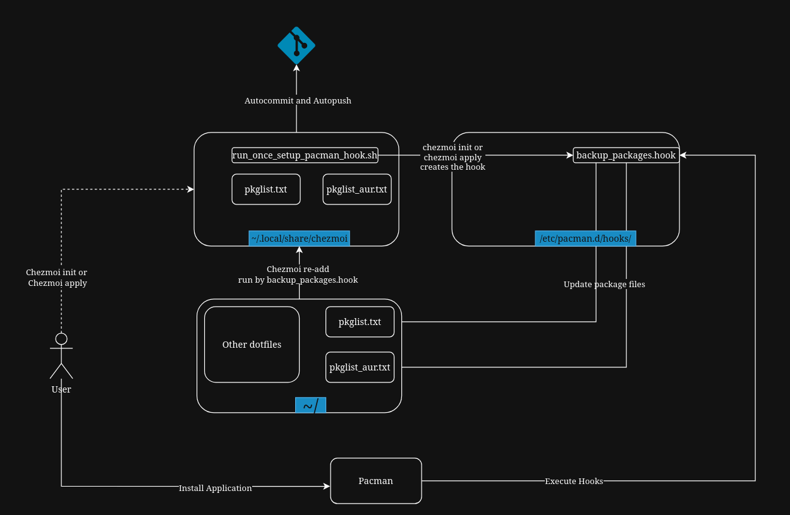

+++
title = "Home is where ~ is"
date = "2026-08-08"
slug = "settling-down-in-arch"
+++

### Settling Down
Over the years, I have been in and out of Linux distros (strictly Debian-based) like staying in an Airbnb. It feels like home but for maybe a week or so. I don't really open locked doors; the basement and attic are off-limits. Eventually I go back home to Windows.

With the Steam Deck, that changed quite a bit! For the very first time, I got a glimpse of Arch Linux. Having never run anything other than `sudo apt-get` in Ubuntu, this was new. The Steam Deck also made everything work out of the box where the user always boots into Gamescope and all the complexity of maintaining packages is abstracted away completely if the user chooses to do so. I started reading the Arch Wiki and tinkering with the Steam Deck, and a few years down the line, I built my own PC.

CachyOS seemed great, it turned out to be so great that I wiped the last Windows machine in my home to install Cachy. With multiple machines, I wanted to have the same base state across all of them where I could work on one machine and pick up right where I left off on another. This also meant that disaster recovery was as easy as running a single command to provision the machine to a working state.

There are a ton of options out there which can do this to varying degrees. Chezmoi caught my eye because it does templates, which checks the box for my multi-machine use case, as well as hooks and `run_once` and `on-change` scripts, which seemed like things I didn't know I needed until I saw them being offered. For now, until another shiny new toy comes around, this is going to be my dotfile manager (among other things).

### Package State Management
One thing I want to do is keep track of installed packages; chezmoi does this through `packages.yaml` but it's an all-or-nothing approach. Either slap everything on or curate them one by one yourself. There is no in between.

The [Arch Wiki](https://wiki.archlinux.org/title/Migrate_installation_to_new_hardware) has a section about extracting packages and then installing them in a new machine. I combined this with pacman post-transaction hooks and chezmoi autocommit and autopush to do automated package tracking. This gives everything in the machine, but that's fine; more information is good information. I can always pick and choose what goes into the new machine.

The overall workflow is like this:



#### Step 1: Create empty files and add them to chezmoi

```bash
touch ~/.config/pkglist.txt
touch ~/.config/pkglist_aur.txt
chezmoi add ~/.config/pkglist.txt ~/.config/pkglist_aur.txt
```

#### Step 2: Create a run_once script

Create the script `run_once_setup_pacman_hook.sh` in `~/.local/share/chezmoi`

```bash
#!/usr/bin/env bash

sudo echo "Starting hook creation..."

REAL_USER="${SUDO_USER:-$USER}"
REAL_HOME=$(sudo getent passwd "$REAL_USER" | sudo cut -d: -f6)
REAL_UID=$(sudo getent passwd "$REAL_USER" | sudo cut -d: -f3)

sudo echo "Creating Pacman hooks directory..."
sudo mkdir -p /etc/pacman.d/hooks

sudo echo "Writing the Pacman hook..."

sudo tee /etc/pacman.d/hooks/backup_packages.hook > /dev/null <<EOF
[Trigger]
Operation = Install
Operation = Upgrade
Operation = Remove
Type = Package
Target = *

[Action]
Description = Backing up packages and updating chezmoi...
When = PostTransaction
Exec = /bin/sh -c "pacman -Qqen > $REAL_HOME/.config/pkglist.txt && (pacman -Qqem > $REAL_HOME/.config/pkglist_aur.txt || true) && sudo -u $REAL_USER XDG_RUNTIME_DIR=/run/user/$REAL_UID DBUS_SESSION_BUS_ADDRESS=unix:path=/run/user/$REAL_UID/bus systemd-run --user --no-block chezmoi re-add"
EOF

sudo echo "Pacman hook updated successfully!"
```

Most of this stuff is self-explanatory except for the last part of the Exec command. At first I was running a simple chezmoi re-add, but since pacman runs a strict non-interactive tty, the git repository address couldn't be resolved. I had to drop to my user session from root, set XDG variables and force systemd process to talk to my D-Bus daemon to get an async, non-blocking handoff to a `chezmoi re-add` process, preventing pacman from failing if chezmoi hangs. Any failure, info or error is logged to the user's systemd journal (accessible via `journalctl`) so I can check later if things seem funky.


#### Step 3: Run chezmoi apply

After editing the script, run_once_* scripts need `chezmoi apply` to execute them. Running `chezmoi apply` runs the script automatically and creates post-transaction pacman hooks.

#### Step 4: Install/Update/Remove apps

The automations are now in place. From here on out, any application installation, update, or removal will trigger the hook. This dumps the currently installed normal and AUR packages to files in the `~/.config` folder and calls `chezmoi re-add`. Chezmoi will then update the files in `~/.local/share/chezmoi`, automatically commit the changes, and push them. The whole execution of this process happens in under 2 seconds.

### Closing thoughts

There is some more polishing that I would do in the future; making sure no duplicate packages are added is one of them. Even though pacman always dumps package lists in alphabetical order, it is still something I would check out.
