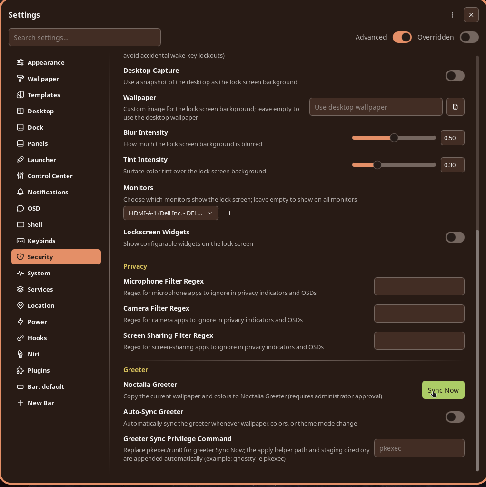
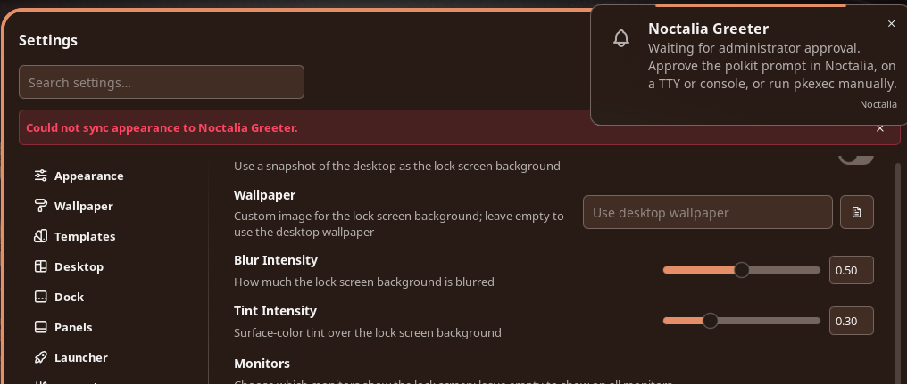
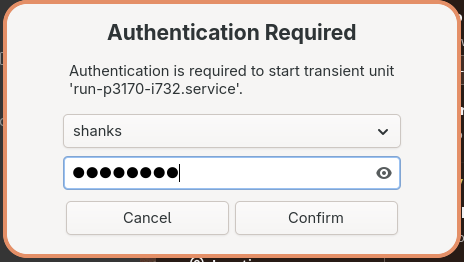

+++
title = "Why this Polkit Package"
date = "2026-08-07"
slug = "choosing-polkit"
+++

# Problem Statement

In an effort to noctalize my whole setup, I did [this](https://yegcsharpdev.github.io/out-with-plasma).
With greetd and noctalia-greeter-session installed, naturally the next step was to sync the desktop wallpaper with the lockscreen. Sounds easy, right?

Not quite because of a minor detail and it tripped me for a few hours.

Clicking "sync" on the settings panel to sync the wallpaper and style brings an error notification.





# Solution

In [Noctalia Greeter Sync](https://docs.noctalia.dev/v5/greeter/#matching-your-noctalia-desktop), the troubleshooting section has one line.

> Sync fails with no privilege escalator - Greeter sync needs pkexec or run0 on PATH (for example when pkexec is disabled on NixOS, install run0 from systemd ≥ 256). A polkit authentication agent must be running in your session.

Which described my situation exactly.

So off I went to the trusty Arch Wiki in search of a Polkit authentication agent.

The [Authentication Agents section](https://wiki.archlinux.org/title/Polkit) lists several options. Some of these names are familiar, like LXQt, MATE, and GNOME, but most of these agents are built specifically for their respective desktop environments.

Soteria-git stood out because it is independent of any specific desktop environment and is also constantly updated.

The only drawback is that it's AUR-only, so due diligence is required when installing and updating packages.

```bash
paru -S soteria-git
```

Now that it's installed and the Arch Wiki specified exactly where the binary is, adding it to the niri autostart.kdl file should make it available when the system starts.

```bash
helix ~/.config/niri/cfg/autostart.kdl
```

Adding this line:
```bash
spawn-at-startup "/usr/lib/soteria-polkit/soteria"
```
And one reboot later—voilà!



Now the lockscreen syncs with desktop wallpaper and colors.

> Note: The initial sync attempt might throw an error; a reboot will resolve it.
